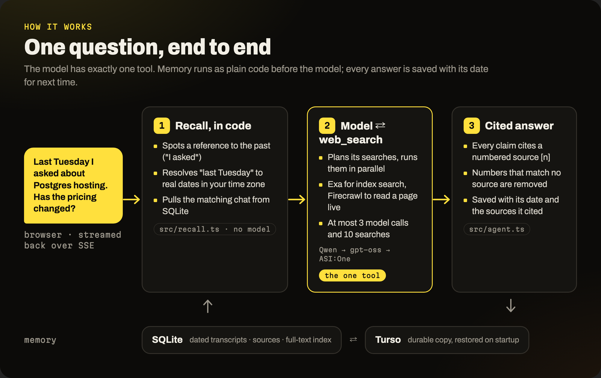
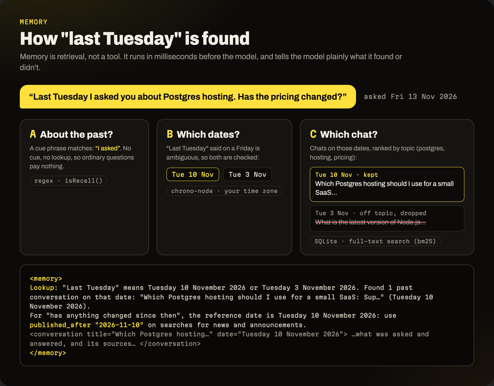
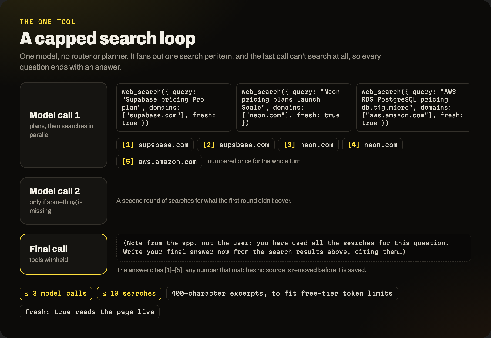
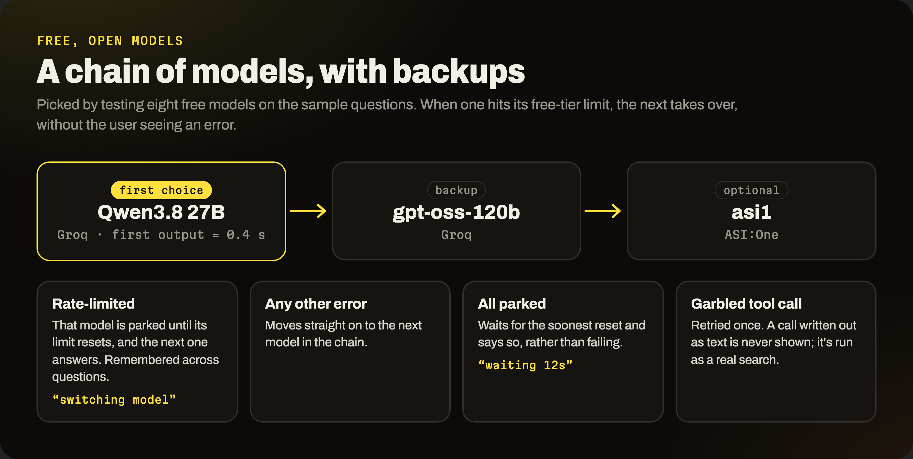

# Recall: design

Recall answers from the live web with sources and remembers what you asked, and when. Ask "last
Tuesday I asked about Postgres hosting, has the pricing changed?" and it finds that chat, re-checks
each vendor's pricing page, and says what changed, citing every line. The model gets exactly one
tool, web search; memory is plain code that runs before it. Live at
**https://recall-search-agent.onrender.com**.

## How it works

Each message runs one turn (`src/agent.ts`):

1. **Recall, in code, before the model.** If the message points at the past ("I asked", "we
   shortlisted", "still correct"), `src/recall.ts` resolves its dates in the user's time zone and
   pulls matching conversations from SQLite by date, ranked by topic with full-text search. "Last
   Tuesday" said on a Thursday is ambiguous, so both Tuesdays are checked. The model receives a
   `<memory>` block: what was or wasn't found, the dated transcript, its sources, and the date to
   search from for "has anything changed since".
2. **One model in a capped tool loop.** The model decides whether to search and fans out one search
   per item in a single step, run in parallel: at most two search rounds and ten searches. Before
   the last step it is told no searches are left, and that step cannot search.
3. **Grounded answer.** Sources are numbered across the turn and the model cites `[n]`; numbers that
   match no source are dropped. The question is saved before the model runs, so a failed answer
   still leaves it in history; the answer and its cited sources are saved after.

## Why this way

- **Memory is retrieval, not a tool.** The brief allows one tool, and "3 November" is a
  `WHERE local_date = ?` clause anyway, resolved in code and tested against a pinned clock. An
  explicit "nothing found" line stops the model inventing a past conversation.
- **Raw dated transcripts, not extracted facts.** "Is your answer still correct?" needs what the
  assistant actually said, which fact stores tend to lose. Each answer's sources are kept too.
- **Re-checks use two kinds of search behind one tool.** An edited pricing page keeps its old
  publish date, so a date-filtered search misses the change. The agent searches news since the
  recalled date (Exa) and re-reads the vendor's page live (Firecrawl, passing on only the relevant
  lines). Each covers for the other when it fails or finds nothing.
- **No router or planner.** Every extra model call delays the first token.
- **Free, open-weight model, chosen by testing.** Of eight free models run on the sample questions,
  Qwen3.8 27B on Groq gave first output in 0.4 s and answered the Postgres re-check in 14 s with 13
  valid citations. DeepSeek V4.1 Flash wrote the best answer but took 118 s; gpt-oss-120b made one
  search where three were needed; three others timed out or errored.
- **Built around free-tier limits.** Groq allows 8,000 tokens per minute per model and a re-check
  uses 7,000 to 15,000, so excerpts are short and old results are not resent. Models form a chain
  (Qwen, gpt-oss, then ASI:One): a rate-limited one is skipped until its limit resets, any other
  failure moves on, and if all are limited the agent says so and waits. A tool call an open model
  garbles or writes out as text is never shown; it is retried or run as a real search.
- **Small stack.** The OpenAI SDK against any compatible host, `node:http` with Server-Sent Events,
  built-in `node:sqlite`, and one HTML file. The Memory tab uses the agent's own store and date
  logic, and shows how it read "last Tuesday".
- **Safe to put online.** Each browser's history is filed under its own random id, and a cap of 60
  questions a day per address protects the free quotas. The host wipes its disk on restart, so every
  write is copied to Turso and restored on startup.
- **Measured, not assumed.** `npm run eval` runs 12 questions end to end: the three sample-question
  shapes, an honest "no conversation that day", live-web lookups, and questions that must not search.
  The checks are deterministic. The last full run passed 11 of 12 cases (47 of 48 checks); the one
  miss, an answer that did not restate the recalled date, passed on a rerun. See `eval/results.md`.

## Considered and rejected

| Option | Why not |
|---|---|
| Claude, GPT or Gemini APIs | Paid; the goal was free, open-weight models. Gives up Claude's built-in citations. |
| Provider-native web search | No date filters, and results can't be stored to compare later |
| Fact-extraction or graph memory | Loses what the assistant actually said; more parts for no gain at this scale |
| Embeddings for recall | Date plus keyword search already finds one user's chats; adds a model and a key |
| Router, query rewriter, multi-agent | Extra model calls before the first token |
| Local Ollama as default | A multi-GB download for reviewers; still works via `LLM_BASE_URL` |
| Tavily, SearXNG | Tavily scored lowest in the 2026 comparisons I reviewed; SearXNG needs Docker |

## Known limits

Recall needs a date or a cue phrase. Citations are prompt-based, so a wrong but existing source
number gets through. Only the last ten messages of a chat are sent to the model. The eval checks
behaviour, not whether every fact is right. On the free tier, rapid-fire questions can wait up to a
minute. History belongs to a browser, not an account.

## With another week

- **A bigger eval with a judge:** about 40 cases, with a judge model grading each claim against its
  cited excerpt, run on every prompt or model change.
- **Claim-level re-verification:** store each answer's claims with their sources, then re-check
  and diff claim by claim instead of answer by answer.
- **Token-aware routing:** read Groq's remaining-token headers and switch models before a refusal,
  not after.
