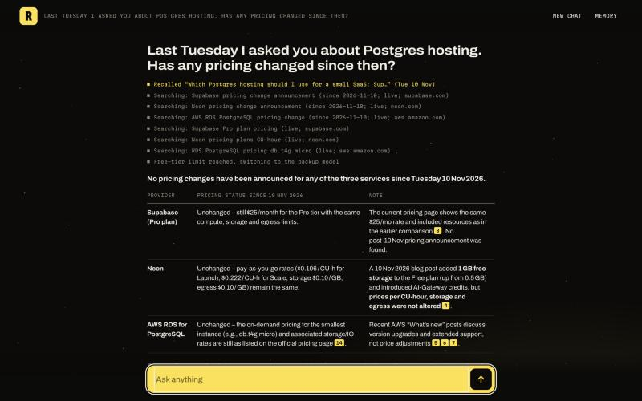
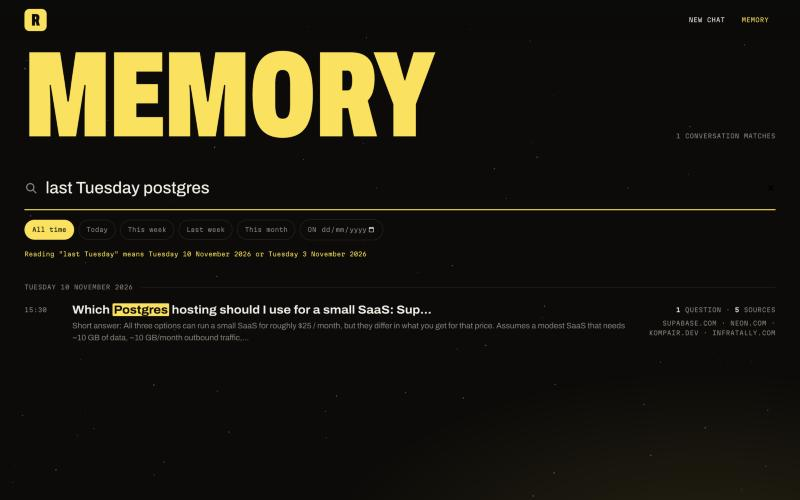

# Recall

**Live demo: https://recall-search-agent.onrender.com** (free hosting, so the first visit after a
quiet spell can take a few seconds)


A chat agent with one tool, web search. It answers fast, cites every fact, and remembers what you
talked about and when, so it can answer "What did I ask you on 3 November? Is your answer still
correct today?" by finding that conversation and re-checking it against the live web.

It runs entirely on free tiers: an open-weight model (Qwen3.8 27B) on Groq and Exa for search.
How it works and why is in [DESIGN.md](DESIGN.md).

## Run it

Needs Node.js 22.13 or newer (it uses the built-in `node:sqlite`).

```bash
npm install
cp .env.example .env    # then add your two keys
npm run dev
```

Open http://localhost:3000.

Keys (both free, no card):

- `LLM_API_KEY`: from [console.groq.com/keys](https://console.groq.com/keys)
- `EXA_API_KEY`: from [dashboard.exa.ai/api-keys](https://dashboard.exa.ai/api-keys)

## Try the memory questions on a fresh install

The sample questions refer to earlier conversations, which a fresh install doesn't have. The start
page has a **Load sample history** button that adds three, dated last Monday, last Tuesday and
3 November. They come from `demo/history.json`, which holds three real agent runs.

To generate your own instead, with fresh searches:

```bash
npm run seed
```

Each seed is a real agent run with the clock set back and search limited to pages published before
that date. It takes about three minutes because it pauses for Groq's free per-minute token limit.
Pages that are edited in place (pricing pages, release lists) can still show newer content than the
seed date.

Then ask, for example:

- "On Monday we shortlisted 5 CRM tools for a 20-person sales team. Has any of them changed pricing or shipped something big since?"
- "Last Tuesday I asked you about Postgres hosting. Has any pricing changed since then?"
- "What did I ask you on 3 November? Is your answer still correct today?"

## What it looks like

Asked "Last Tuesday I asked you about Postgres hosting. Has any pricing changed since then?", it
finds that conversation, searches for changes since that date, and reports each item as unchanged
or changed, with sources:



## The Memory tab

Everything you have asked, grouped by day, with each conversation's sources. One search box takes
keywords and date phrases together: "last Tuesday postgres" reads the date the same way the agent
does, says how it read it, and shows the matching conversations with the words highlighted. Chips
filter to today, this week, last week or this month, or pick a single day.



## Deploy

The repo includes a [Render](https://render.com) blueprint (`render.yaml`) for its free plan:

1. Open https://render.com/deploy?repo=https://github.com/vaibhav375/minimi-search-agent
2. Sign in with GitHub and enter `LLM_API_KEY` and `EXA_API_KEY` when asked.

Any Node host works: run `npm install`, then `npm start` with `HOST=0.0.0.0` and the two keys set.

On a public deployment each browser gets a random id and sees only its own history (it is not a
login: anyone with the id could read that history). Each address is limited to 60 questions a day so
a public demo cannot drain the free API quotas.

Render's free plan wipes the disk on every restart. To keep history, create a free database at
[Turso](https://app.turso.tech) and set `TURSO_DATABASE_URL` and `TURSO_AUTH_TOKEN` on the service:
every write is copied there, and the history is restored from it on startup.

A scheduled GitHub Action (`.github/workflows/keep-awake.yml`) pings the site every five minutes so
the free instance doesn't fall asleep between visitors.

## Tests

```bash
npm test          # 23 tests: date resolution, recall, memory search, visitor isolation, the agent loop, rate-limit fallback
npm run typecheck
npm run eval      # end-to-end: real model and search on 12 scripted questions; writes eval/results.md
```

The tests use a fake model and fake search, so they need no keys and make no network calls.

## Optional extras

All optional; the agent runs without them.

| Key | What it adds |
|---|---|
| `FIRECRAWL_API_KEY` | When the agent re-checks a vendor's own page (a pricing page, say), Firecrawl loads it live in a real browser, so pages built by JavaScript or edited in place are read as they are now. It also takes over a search when Exa fails or finds nothing. |
| `ASI_API_KEY` | ASI:One as a third model, used only when both Groq models have failed or hit their limits. |
| `TURSO_DATABASE_URL`, `TURSO_AUTH_TOKEN` | A durable copy of the history, for hosts that wipe the disk on restart. |

## Free-tier limits

Groq's free tier allows each model 8,000 tokens per minute and 1,000 requests per day. A question
that fans out to five searches can use most of a minute's budget. When the main model is limited,
the agent switches to the fallback model, and if both are limited it waits (up to a minute) with a
visible status rather than failing. A paid Groq tier, or another host via `LLM_BASE_URL`, removes
the waits.

## Layout

| File | What it does |
|---|---|
| `src/agent.ts` | One chat turn: recall, then the model and search loop, then the cited answer is saved |
| `src/recall.ts` | Resolves dates like "last Tuesday" and builds the memory block for the model |
| `src/store.ts` | SQLite storage: dated transcripts, sources, full-text index |
| `src/search.ts` | The web search tool: Exa, plus Firecrawl for live page reads and as a fallback |
| `src/llm.ts` | Model client: a chain of OpenAI-compatible models (Groq, then optionally ASI:One) |
| `src/prompt.ts` | System prompt and tool definition |
| `src/server.ts` | HTTP server and streaming chat endpoint |
| `src/demo.ts`, `demo/history.json` | Sample history a visitor can load |
| `public/index.html` | The chat UI (GSAP and Lenis for motion and scrolling) |
| `scripts/seed.ts` | Generates back-dated conversations with real searches |
| `src/mirror.ts` | Optional durable copy of the history in Turso |
| `scripts/eval.ts`, `eval/results.md` | End-to-end eval and its latest results |
| `render.yaml` | Render deployment blueprint |
